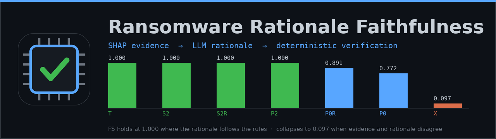
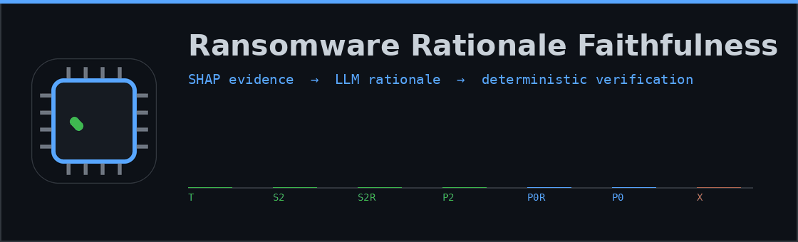
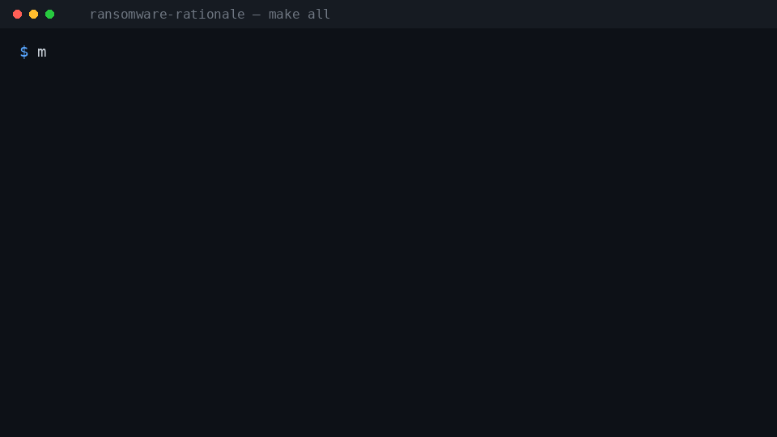
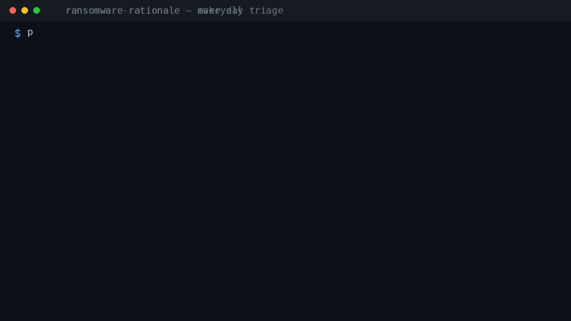
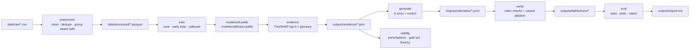

<p align="center">
  
</p>

# Faithfulness-Checked LLM Rationales for Ransomware Verdicts

**Can an LLM explain a malware classifier's verdict without lying about the evidence?**

This project trains a tabular ransomware classifier on memory-forensics features
(CIC-MalMem-2022), feeds its SHAP evidence to an LLM that writes a natural-language
rationale, and then scores how *faithful* that rationale is to the evidence with a
deterministic metric — claim verification, evidence coverage and causal ablation.
Fluency is explicitly **not** the target: the whole point is to measure the gap
between "reads well" and "matches the evidence".

<p align="center">
  
  &nbsp;&nbsp;
  
</p>

<p align="center">
  
</p>


-yellow)


-blueviolet)

> The logo/banner assets are generated, not drawn: `make brand` (or
> `python scripts/make_brand_assets.py`) rebuilds `docs/logo.svg`, `docs/logo.png`,
> `docs/banner.png` and `docs/banner.gif` from the real per-arm scores in
> `outputs/faithfulness/all_arms_summary.json`, so the banner can never drift from
> the study. Same for `docs/demo*.gif` (`make docs`).

---

## Results at a glance

Final run: 50 held-out samples, 6 generation arms + 1 negative control, one LLM
(agent-backed), all scored with the same metric.

| arm | what it is | Faithfulness Score (mean [95% CI]) | pass rate |
|---|---|---|---|
| `T`   | deterministic template (sanity ceiling) | **1.000** [1.000, 1.000] | 1.00 |
| `P0`  | zero-shot prose | **0.772** [0.728, 0.815] | 0.78 |
| `P0R` | `P0` + verify-and-repair loop | **0.891** [0.847, 0.929] | 0.96 |
| `P2`  | rules + few-shot prose | **1.000** [1.000, 1.000] | 1.00 |
| `S2`  | structured JSON, machine-checkable | **1.000** [1.000, 1.000] | 1.00 |
| `S2R` | `S2` + verify-and-repair loop | **1.000** [1.000, 1.000] | 1.00 |
| `X`   | control: rationale paired with another sample's evidence | **0.097** [0.039, 0.166] | 0.02 |

* **RQ1** — zero-shot prose is mostly grounded but not always: precision 0.92,
  hallucination rate 4.5 %, contradiction rate 3.2 %.
* **RQ2** — the repair loop works: 22/50 prose samples repaired, mean FS
  0.772 → 0.891, pass rate 0.78 → 0.96 (structured arms already sit at the
  ceiling, so `S2R` has nothing to fix).
* **RQ3** — fluency proxies do **not** track faithfulness: within the zero-shot
  arm, length / readability / ROUGE-L correlate with FS at |ρ| ≤ 0.09.
* **RQ4** — the causal ablation confirms cited features matter: comprehensiveness
  lift ≈ 0.27 for faithful arms vs 0.15 for zero-shot prose.

Full write-up: **[outputs/report.md](outputs/report.md)** ·
classifier card: **[outputs/classifier_report.md](outputs/classifier_report.md)**

> The classifier reaches **ROC-AUC 0.9273** on a leakage-free, capture-group-aware
> split. The familiar 0.95+ numbers on this dataset come from near-duplicate
> leakage across splits (0.9561 here) — see
> [docs/DEVIATIONS.md](docs/DEVIATIONS.md) and `models/metrics_rowlevel.json`.

---

## Quickstart

```bash
git clone <this repo> && cd ransomware-rationale
cp .env.example .env                     # no secrets needed for the default backend
                                         # (tested on CPython 3.14; 3.11+ should work)

make setup                               # venv + pinned dependencies
make download                            # CIC-MalMem-2022 -> data/raw/ (Kaggle/HF mirror)
make all                                 # preprocess -> train -> evidence -> generate ->
                                         # verify -> validity -> eval -> test -> checks

cat outputs/report.md                    # the study
python -m src.utils.checks               # acceptance-check table
```

`make generate` may exit with code **20** (`WAITING_FOR_AGENT`): the default LLM
backend is *the agent itself* (`agent_queue`). Answer the prompts written to
`queue/requests.jsonl` by appending to `queue/responses.jsonl`
(see [queue/HOWTO.md](queue/HOWTO.md)) and re-run the same command — or point
`LLM_BACKEND` at an OpenAI-compatible endpoint / Ollama instead
([docs/USAGE.md](docs/USAGE.md#llm-backends)).

All LLM calls are cached in `cache/llm/`, so re-runs are free.

## Who this is for (use cases)

The same model and the same verifier serve several quite different jobs. Read the
row that matches you; each one has copy-paste commands further down.

| you are… | you want | start here | what you must not over-read |
|---|---|---|---|
| **a security analyst** doing triage | a verdict on one memory sample *plus* a written explanation you can trust | `python -m src.cli check --csv dump_row.csv` | a `benign` verdict means "not ransomware", **not** "clean" — Trojan/Spyware samples are negatives in this task |
| **an ML engineer** shipping LLM explanations | to know when a generated rationale contradicts its own evidence, and how to detect it without a second LLM | [the metric](#6-the-faithfulness-metric) + `make verify` | the metric checks *claims against the evidence table*, not the truth of the evidence itself |
| **a researcher** reproducing/falsifying this study | a frozen pipeline, an honest split, and a self-attacking metric | `make all` then [outputs/report.md](outputs/report.md), [docs/DEVIATIONS.md](docs/DEVIATIONS.md) | N=50; differences below ~0.05 are not reliable |
| **an agent / tool builder** | a stable JSON contract for triage | [skills/malware-triage/SKILL.md](skills/malware-triage/SKILL.md) + `--json` | `--fail-on-unfaithful` is the machine-readable gate; exit code 20 means "answer the queue" |
| **a student** learning the pipeline | runnable notebooks that show every step on real data | [notebooks/](#notebooks) | they use the trained artifacts, so `make train` first |
| **a reviewer** auditing whether an extra model is worth it | a measured answer, not a pitch | [the Laya verdict](#optional-a-non-generative-second-opinion-laya) | the layer is diagnostic-only and **cannot** move `FS` |

### What this project is *not*

* Not a malware detector: ransomware vs. everything else, on 55 pre-extracted
  Volatility features. It never touches a PE file or a raw memory dump.
* Not a causal explanation system: SHAP values are model attributions, and the
  causal tests (`causal.py`) are ablations under the model, not ground truth.
* Not a benchmark leaderboard: the classifier number is deliberately the honest,
  leakage-free one (0.9273), not the leaky 0.9561.

## Notebooks

Two self-contained walkthroughs that run on the *trained* artifacts — no Jupyter
required (`make notebooks` executes every code cell with plain Python and writes
the figures to `outputs/figs/`).

| notebook | what it shows step by step |
|---|---|
| [notebooks/01_train_the_classifier.ipynb](notebooks/01_train_the_classifier.ipynb) | what one row of CIC-MalMem-2022 actually is · the 70/10/20 **capture-group-aware** split (and why the leaky split flatters the model) · training a small XGBoost in ~5 s · ROC-AUC / PR-AUC / confusion matrix · calibration curve · TreeSHAP importance · what `make train` adds on top (RandomizedSearchCV, early stopping, sigmoid calibration) |
| [notebooks/02_check_a_sample_end_to_end.ipynb](notebooks/02_check_a_sample_end_to_end.ipynb) | one held-out sample → calibrated verdict → top-6 SHAP evidence table → the deterministic template rationale → the faithfulness check → **four hand-written explanations** (a faithful baseline plus a flipped direction, a wrong value and an invented feature — the verdict is right in all four, only the claim-level check exposes the lies) → how to plug in a real LLM (`--explain llm`) |

```bash
make notebooks        # no Jupyter needed: runs every cell, writes outputs/figs/notebook0*.png
jupyter lab notebooks/   # or bring your own front end
```

## Usage examples

Every recipe below is copy-pasteable. The first block needs only
`make setup download preprocess train evidence` — no LLM, no network, no API key.

**1 · Triage one memory sample (the everyday path)**

```bash
python -m src.cli info                                  # what model is loaded, where
python -m src.cli check --sample test_031534            # a held-out eval sample
python -m src.cli check --sample test_031534 --json | jq .faithfulness
python -m src.cli template --out my_sample.csv          # an editable 55-feature row
python -m src.cli check --csv my_sample.csv            # score your own row
python -m src.cli check --csv my_sample.csv --allow-missing   # median-fill gaps (flagged)
```

**2 · Make it explain with an LLM, then verify and repair that explanation**

```bash
# no key needed: the agent answers via the queue (exit 20 → answer → re-run)
python -m src.cli check --sample test_031534 --explain llm --repair 2 --save rec.json

# or point at any OpenAI-compatible endpoint / local Ollama
LLM_BACKEND=openai_compat LLM_BASE_URL=... LLM_MODEL=... \
  python -m src.cli check --sample test_031534 --explain llm --mode structured --repair 1
LLM_BACKEND=ollama OLLAMA_HOST=http://localhost:11434 \
  python -m src.cli check --sample test_031534 --explain llm --prompt-version v2
```

**3 · Gate CI on explanation quality**

```bash
python -m src.cli batch --csv dumps.csv --stride 200 --limit 100 \
    --explain template --out outputs/triage_batch.csv
# exit 1 as soon as an explanation is not faithful → fails the job
python -m src.cli check --csv my_sample.csv --explain template --fail-on-unfaithful
```

**4 · Use it from code / an agent**

```python
import json, subprocess
rec = json.loads(subprocess.run(
    ["python", "-m", "src.cli", "check", "--csv", "dump.csv", "--explain", "template", "--json"],
    capture_output=True, text=True, check=True).stdout)
fs = rec["faithfulness"]
print(fs["FS"], fs["status_counts"], [c["feature"] for c in fs["per_claim"]
                                       if c["status"] != "supported"])
```

**5 · Reproduce or attack the study itself**

```bash
make all                                # whole pipeline, ~2 min + your LLM time
FORCE=1 make verify                     # re-extract and re-score every rationale
python -m src.evaluation.validity       # perturbations, corrupted evidence, gold set
python -m src.evaluation.report_md      # rebuild outputs/report.md from artifacts

# does the metric actually detect lies? (exit 0 = recall >= 0.95 on all 4 corruptions)
python -m pytest tests/test_metric_validity.py -q
```

**6 · Run the optional Laya cross-check on one sample**

```bash
make setup-laya                         # ~1.2 GB (CPU torch); see the verdict below
python -m src.cli check --sample test_031534 --explain template --decide laya
```

---

> **New here?** You do **not** need `make all` to use this project. That command
> reproduces the *research study*. For everyday use jump to
> **[Real-world usage](#real-world-usage--everyday-triage)** below, or open
> **[`notebooks/01_train_the_classifier.ipynb`](notebooks/01_train_the_classifier.ipynb)**
> if you want to see how the model is trained, step by step, in a few seconds.

---

## Real-world usage — everyday triage

### The mental model (60 seconds)

A "file" here is **not** a `.exe`. It is a **memory image summarised by 55 numbers**
produced by Volatility memory-forensics plugins — `pslist.nproc`, `dlllist.ndlls`,
`malfind.ninjections`, `handles.nmutant`, `svcscan.nservices`, … One row of
`data/raw/CIC-MalMem-2022.csv` is one such sample, and that row is exactly what the
classifier eats. That is why the tool takes a CSV row and not a virus file.

The project answers two *different* questions, and reports both:

| question | answered by | how |
|---|---|---|
| "is this sample ransomware?" | the XGBoost classifier | `verdict` + `p(ransomware)` |
| "is the explanation of that verdict telling the truth?" | the deterministic verifier | `FS` + per-claim statuses |

The second question is the whole point of the project — an explanation that reads
well is not the same as an explanation that matches the evidence.

<p align="center">
  
</p>

That GIF is a real run of
`python -m src.cli check --sample test_031534 --explain llm --prompt-version v0 --repair 2`:
the classifier **missed** this ransomware sample, the model explained the wrong
verdict, the verifier caught a claim that contradicted the evidence
(`malfind.commitCharge` said to push toward *benign*, evidence says *ransomware*),
and one repair round made the explanation faithful again (FS 0.913 → 1.000).

### 1. Check one sample (fastest start, offline)

```bash
python -m src.cli info                          # what model is loaded, where things are
python -m src.cli check --sample test_031534    # any id from data/eval/eval_ids.json
```

```text
==============================================================================
 SAMPLE test_031534   (source: data/processed/test.parquet)
 scope: this classifier answers 'is it ransomware?' (ransomware vs everything else, incl. other malware)
==============================================================================
 Dataset label      : ransomware  (family: Maze)
 Classifier verdict : benign / not ransomware   p(ransomware) = 0.0541   (threshold 0.50)
 Classifier vs label: WRONG  (binary task)

 Evidence: top 6 features by |SHAP| (shap.TreeExplainer, covers 43% of SHAP mass)
  1. handles.nmutant                  value    282.0  typical    47.8th pct  toward_benign      SHAP -0.746
  2. malfind.ninjections              value     78.0  very_high  99.0th pct  toward_benign      SHAP -0.622
  3. handles.ntimer                   value    129.0  typical    48.0th pct  toward_benign      SHAP -0.575
  4. pslist.avg_threads               value     7.55  very_low    0.8th pct  toward_ransomware  SHAP +0.507
  5. handles.nfile                    value    681.0  typical    44.0th pct  toward_benign      SHAP -0.416
  6. malfind.commitCharge             value    9,215  very_high  95.5th pct  toward_ransomware  SHAP +0.370

 Explanation (template):
  The classifier predicts benign with probability 0.054. handles.nmutant is typical compared with
  training data (value 282.0, 48th percentile), which pushed the decision toward benign. ...

 Faithfulness check of that explanation:
   stated verdict matches classifier : yes
   Faithfulness Score FS = 1.000  (PASS)   claims 6: 6 supported, 0 unsupported, 0 contradicted
   [ok] handles.nmutant                  supported     all checks passed
   [ok] malfind.ninjections              supported     all checks passed
   ...
```

No LLM and no API key are needed: `--explain template` is the default, deterministic
and faithful by construction, so you always get a *verified* explanation offline.
Handy flags: `--top-k 8`, `--split val`, `--save out.json`, `--json` (see below),
`--fail-on-unfaithful` (exit code 1 when the explanation fails, for scripts).

### 2. Check a sample you have as a CSV row

```bash
python -m src.cli template --out my_sample.csv     # 55 feature columns + Category, prefilled
# ... edit the numbers with the counts from your memory image (Volatility plugins) ...
python -m src.cli check --csv my_sample.csv        # or --row 3 for the 4th row
```

The CSV must contain the 55 feature names listed in
[data/processed/features.json](data/processed/features.json) (extra columns like
`Category`/`Class` are ignored but used to show ground truth when present). If some
are missing the tool refuses and names them; `--allow-missing` fills them with the
training median and warns you that the verdict is then less trustworthy.
You can also pass a JSON object: `--json-file sample.json`.

### 3. Ask a real LLM to explain it — and verify the explanation

```bash
# local model, nothing leaves the machine
LLM_BACKEND=ollama LLM_MODEL=llama3.2:3b python -m src.cli check --sample test_030109 --explain llm
# or: LLM_BACKEND=openai_compat (+ LLM_BASE_URL / LLM_API_KEY / LLM_MODEL in .env)
# or: no key at all — the agent queue answers the prompt (queue/HOWTO.md)
python -m src.cli check --sample test_030109 --explain llm --mode structured --repair 2
```

The output adds three things on top of the classifier verdict: the model's prose, the
**faithfulness verdict** for that prose, and (with `--repair N`) the trail of the
verify-and-repair loop. From the GIF run:

```text
 Faithfulness check of that explanation:
   stated verdict matches classifier : yes
   Faithfulness Score FS = 1.000  (PASS)   claims 6: 6 supported, 0 unsupported, 0 contradicted
   [ok] handles.nmutant                  supported     all checks passed
   [ok] malfind.commitCharge             supported     all checks passed
   repair loop: round 0: FS 0.913 -> round 1: FS 1.000
```

and round 0 — the explanation the model wrote on its own — was rejected with:

```text
VERIFIER FEEDBACK ON YOUR PREVIOUS ANSWER (fix every issue)
- Claim about 'malfind.commitCharge' says toward_benign but the evidence says toward_ransomware.
Rewrite the rationale using ONLY the evidence table and these corrections. Keep roughly the same length.
```

That is a claim-level check, so it survives an explanation that *sounds* right. A
quick way to see it fail on purpose: `--fail-on-unfaithful` on a zero-shot answer that
cites a feature outside the evidence list exits **1** and marks the claim
`out_of_topk`. Notebook 02 shows the same thing with three hand-written lies.

### 4. Batch-triage a CSV (a folder of dumps)

```bash
# the dataset's rows are ordered by class, so stride through them for a realistic mix
python -m src.cli batch --csv data/raw/CIC-MalMem-2022.csv --stride 1500 --limit 30
```

```text
[ 1/30] CIC-MalMem-2022#row0: benign p=0.029  label=benign
...
[30/30] CIC-MalMem-2022#row29: benign p=0.033  label=not ransomware (spyware)

wrote outputs/triage_batch.csv  (30 rows: 5 ransomware, 25 benign)
accuracy vs dataset labels: 96.7%
```

[outputs/triage_batch.csv](outputs/triage_batch.csv) has one row per sample: verdict,
probability, dataset label, whether the classifier was right, the top features behind
the verdict, and (with `--explain template`) the faithfulness score of each row's
explanation. `make triage` is the same thing with `CSV=/STRIDE=/LIMIT=` overrides.

### 5. Use it as a tool or a skill from another program/agent

`--json` prints exactly one JSON object on stdout and nothing else, so any caller can
consume it:

```bash
python -m src.cli check --sample test_031534 --explain template --json
```

```json
{
  "sample_id": "test_031534",
  "source": "data/processed/test.parquet",
  "ground_truth": {"label": "ransomware", "malware_class": "Ransomware", "family": "Maze"},
  "verdict": "benign",
  "predicted_label": 0,
  "probability_ransomware": 0.054099,
  "threshold": 0.5,
  "top_features": [
    {"rank": 1, "name": "handles.nmutant", "value": 282.0, "shap": -0.746,
     "direction": "toward_benign", "percentile_vs_train": 47.75,
     "qualitative_level": "typical", "description": "Number of open mutant (mutex) handles."},
    {"rank": 2, "name": "malfind.ninjections", "value": 78.0, "shap": -0.622,
     "direction": "toward_benign", "percentile_vs_train": 99.03,
     "qualitative_level": "very_high", "description": "Number of memory regions flagged as injected/…"}
  ],
  "shap_mass_covered_by_top_k": 0.4285,
  "shap_implementation": "shap.TreeExplainer",
  "explanation": {"mode": "template", "backend": "deterministic", "model": null,
                  "text": "The classifier predicts benign with probability 0.054. …",
                  "rationale": {"verdict": "benign", "claims": ["…6 claims…"]}},
  "faithfulness": {"FS": 1.0, "FS_pass": true, "claim_precision": 1.0, "n_claims": 6,
                   "status_counts": {"supported": 6, "unsupported": 0, "contradicted": 0},
                   "per_claim": [{"feature": "handles.nmutant", "status": "supported",
                                  "failed_checks": []}]},
  "warnings": []
}
```

(Abridged: 2 of 6 evidence rows are shown, `ground_truth` fields and `generated_at`
are trimmed, and the prose is elided with `…`.)

From Python (or any language):

```python
import json, subprocess
out = subprocess.run(["python", "-m", "src.cli", "check", "--csv", "dump.csv", "--json"],
                     capture_output=True, text=True, check=True)
rec = json.loads(out.stdout)
if rec["faithfulness"] and not rec["faithfulness"]["FS_pass"]:
    print("explanation not trustworthy:", rec["faithfulness"]["per_claim"])
```

A ready-made agent skill that teaches a coding agent this contract (when to use
`--explain template` vs `--explain llm`, how to read `FS`, what never to claim in the
answer) lives in [skills/malware-triage/SKILL.md](skills/malware-triage/SKILL.md).
Drop the `skills/` folder into an agent that supports skills and it can triage samples
without knowing anything else about this repo.

### How to read the output

| line | meaning |
|---|---|
| `Dataset label` | ground truth from the dataset (only when the sample came from the dataset/CSV) |
| `Classifier verdict` | what the model says, with the calibrated probability and the 0.5 threshold |
| `Classifier vs label: WRONG` | the model got this one wrong — faithful explanations for wrong verdicts are deliberately part of the study |
| `Evidence: top N ... (covers X% of SHAP mass)` | exact TreeSHAP contributions; X% tells you how much of the total explanation the list accounts for |
| `percentile` + `qualitative_level` | where the value sits in the **training** distribution (`very_low` … `very_high`) — this is what the explanation is allowed to say |
| `direction` | whether that feature pushed the decision toward ransomware or toward benign |
| `FS = ...` | composite Faithfulness Score = verdict agreement × claim precision^0.5 × (0.5 + 0.5·evidence coverage) |
| `[!!] feature ... value_ok` | a specific claim failed a specific check (`direction_ok`, `level_ok`, `value_ok`, `feature_exists`) — the explanation lied about that detail |
| `repair loop` | FS per round when `--repair` was used |
| `WARNING` | real-triage caveats: near-threshold probability, or a sample labelled as another malware class |

### Notebooks — the same thing, step by step

See **[Notebooks](#notebooks)** near the top for the full contents of both. In
short: notebook 01 trains the classifier, notebook 02 checks one sample end to end
and catches three hand-written lies.

```bash
jupyter lab notebooks/            # or VS Code / any Jupyter front end
make notebooks                    # no Jupyter needed: runs every code cell with plain Python
```

### What `make all` does, in plain words

You only need this once (to reproduce the study). Each stage is skippable and
re-runnable with `FORCE=1`:

| stage | what it actually does | produces |
|---|---|---|
| `setup` | creates the venv and installs pinned dependencies | `.venv/` |
| `download` | fetches CIC-MalMem-2022 | `data/raw/CIC-MalMem-2022.csv` |
| `preprocess` | cleans, drops duplicate rows, derives labels, splits 70/10/20 **by memory capture** | `data/processed/*.parquet`, `features.json` |
| `train` | tunes XGBoost (`RandomizedSearchCV`), early-stops, calibrates the probabilities | `models/clf.joblib`, `calibrator.joblib`, metrics |
| `evidence` | TreeSHAP top-6 table per evaluation sample, checked for additivity and schema | `outputs/evidence/*.json` |
| `cli` | smoke-tests the everyday triage CLI (one sample, `info`, a 5-row batch) | `outputs/triage_smoke.csv` + two `usage` acceptance rows |
| `generate` | writes 6 kinds of rationale (template, zero-shot, few-shot, structured, repaired) — this is where an LLM is called | `outputs/rationales/*.jsonl` |
| `verify` | extracts claims from every rationale and scores them against the evidence | `outputs/faithfulness/*` |
| `validity` | attacks the metric itself (perturbations, corrupted evidence, gold set, fluency) | `outputs/validity.json` |
| `eval` | statistics, confidence intervals, plots, the report | `outputs/report.md`, `outputs/figs/` |
| `notebooks` | executes both notebooks | `outputs/figs/notebook0*.png` |
| `laya_gate` | **optional, off by default**: a non-generative second opinion (verdict gate + claim cross-judge). A no-op unless it is installed and opted into. | `outputs/laya/` |
| `test` | unit tests (46) | — |
| `checks` | prints the acceptance-check table and validates doc links | `outputs/phase_checks.json` |

---

## 1. What this project does

```
memory-forensics features ──► XGBoost classifier ──► SHAP evidence JSON
                                                          │
                                                          ▼
                          ┌──────────────► LLM rationale generator (arms T/P0/P0R/P2/S2/S2R)
                          │                               │
                          │                               ▼
                          │                 deterministic faithfulness scorer
                          │            (claim checks + coverage + causal ablation)
                          │                               │
                          └──────── verify-and-repair ────┘
                                                          │
                                                          ▼
                                          stats / plots / report.md
```

1. **Train** a tabular classifier (XGBoost; LightGBM is one config line away).
2. **Explain** each of 50 held-out predictions with exact TreeSHAP: top-6
   features with value, direction, train percentile, qualitative level and a
   hand-written glossary description.
3. **Generate** rationales from that evidence with several prompt strategies
   (deterministic template, zero-shot prose, rules + few-shot prose, structured
   JSON, and repair-loop variants).
4. **Verify** every claim in every rationale against the evidence, deterministically.
5. **Validate** the metric itself: synthetic perturbations, a corrupted-evidence
   control, a labelled extractor gold set and fluency-decoupling tests.
6. **Ship the everyday entry point**: `python -m src.cli` checks one sample (verdict +
evidence + explanation + faithfulness), optionally asks a real LLM and repairs its
answer until it is faithful — see [Real-world usage](#real-world-usage--everyday-triage).

## 2. Architecture



Module-by-module detail, data contracts and core code excerpts:
**[docs/ARCHITECTURE.md](docs/ARCHITECTURE.md)**.

## 3. Dataset — where it is downloaded and where it lands

| item | value |
|---|---|
| dataset | CIC-MalMem-2022 (memory-forensics, 58 596 rows × 57 columns) |
| downloader | [src/data/download.py](src/data/download.py) (`make download`) |
| download chain | official UNB/CIC scrape → **Kaggle CLI** → HuggingFace Hub → manual drop |
| working source | Kaggle mirror `luccagodoy/obfuscated-malware-memory-2022-cic` (credentials in `~/.kaggle/kaggle.json`) |
| landing path | **`data/raw/CIC-MalMem-2022.csv`** (18.9 MB) + `data/raw/download_info.json` |
| validation | ≥ 50 000 rows, ≥ 50 columns, `Class`/`Category` labels present |
| processed | `data/processed/{all,train,val,test}.parquet`, `features.json`, `splits.json` |

The official CIC host now serves a registration form, so the Kaggle mirror is the
working path on this machine (documented in [docs/DEVIATIONS.md](docs/DEVIATIONS.md)).
Preprocessing dedupes to 58 023 rows, derives binary/3-class/family labels and a
`group_id` from the capture hash in `Category`
(`Ransomware-Shade-<hash>-7.raw`), and splits **70/10/20 by capture group** so
10 near-duplicate rows from one memory dump can never straddle train and test.

## 4. The classifier (XGBoost / LightGBM)

* **Where:** [src/models/train.py](src/models/train.py) (`make train`),
  calibration in [src/models/calibrate.py](src/models/calibrate.py),
  selection in `configs/default.yaml` → `model: xgboost` (set `lightgbm` to switch).
* **Fixed settings:** `tree_method="hist"`, `n_jobs=4`, `random_state=42`,
  `eval_metric` logloss for probing / `auc` for early stopping.
* **Search:** `RandomizedSearchCV`, 3-fold, `average_precision`, budget-bounded
  (1200 s), space
  `max_depth [3,4,6,8] · learning_rate [.05,.1,.2,.3] · subsample [.7,.85,1] ·
  colsample_bytree [.6,.8,1] · min_child_weight [1,3,5,10] ·
  reg_lambda [.5,1,5] · reg_alpha [0,.5,2]` (LightGBM: `num_leaves`,
  `min_child_samples` instead).
* **Best params found:** `max_depth=8, learning_rate=0.2, subsample=0.7,
  colsample_bytree=0.8, min_child_weight=1, reg_lambda=1.0, reg_alpha=0.0`
  (CV AP 0.6822, 30 trials in 226 s) — saved to `models/best_params.json`.
* **Early stopping:** 50 rounds on a 10 % train slice → **191 trees**, then refit
  on the full train split.
* **Calibration:** `CalibratedClassifierCV(FrozenEstimator(booster), method="sigmoid")`
  fitted on the validation split (5 813 rows) → `models/calibrator.joblib`.

Held-out test metrics (n = 11 670, group-aware split):

| metric | raw booster | calibrated |
|---|---|---|
| ROC-AUC | 0.92726 | 0.92726 |
| PR-AUC | 0.69773 | 0.69773 |
| accuracy | 0.8847 | 0.8867 |
| precision / recall / F1 | 0.657 / 0.609 / 0.632 | 0.680 / 0.571 / 0.621 |
| Brier | 0.0822 | 0.0849 |
| confusion (TN/FP/FN/TP) | 9170/604/741/1155 | 9265/509/813/1083 |

Validation ROC-AUC 0.9519. Row-level (leaky) control split: ROC-AUC 0.9561 —
kept in `models/metrics_rowlevel.json` to make the leakage effect explicit.

## 5. Rationale arms

| arm | prompt | mode | repair loop |
|---|---|---|---|
| `T` | deterministic template from the evidence | — | — |
| `P0` | `v0` zero-shot | prose | — |
| `P2` | `v2` strict rules + 2 few-shot examples | prose | — |
| `S2` | `v2` strict rules + 2 few-shot examples | structured JSON | — |
| `S2R` | = `S2` | structured JSON | ≤ 2 verify-and-repair rounds |
| `P0R` | = `P0` | prose | ≤ 2 verify-and-repair rounds |
| `X` | negative control: an `S2` rationale paired with *another* sample's evidence | — | — |

Templates live in [prompts/](prompts) (`system_v0.txt`, `system_v1.txt`,
`system_v2.txt`), the hand-written few-shots in
[prompts/fewshot.json](prompts/fewshot.json) (built from real train-split
evidence by [scripts/make_fewshot.py](scripts/make_fewshot.py)).

## 6. The faithfulness metric

Each extracted claim is verified deterministically
([src/faithfulness/verify.py](src/faithfulness/verify.py)):

| check | meaning |
|---|---|
| `feature_exists` | feature is in the evidence table (`out_of_topk` if it exists in the dataset but is not listed) |
| `direction_ok` | stated direction matches the SHAP sign |
| `level_ok` | stated qualitative level matches the train-percentile band |
| `value_ok` | every non-percentile number matches the evidence value (±5 %) |
| verdict/probability | stated verdict must match, probability ±0.02 |

Aggregates: claim precision (+lenient variant), hallucination rate, contradiction
rate, SHAP-mass evidence coverage, verdict consistency and the composite

```
FS = verdict_ok · claim_precision^0.5 · (0.5 + 0.5 · evidence_coverage)
```

with weight/α sensitivity reported. On top of that, a **causal ablation** test
(median imputation + marginal resampling, versus random-feature and top-SHAP
controls) checks whether the cited features actually move the classifier.

## 7. Metric validity

* synthetic perturbations of faithful rationales — detection recall
  **1.00 / 1.00 / 0.98 / 1.00** (flip direction, out-of-top-k feature, +30 % value, drop top);
* corrupted-evidence control — FS 1.000 → **0.097** (drop 0.903);
* extractor gold set (agent-drafted, 20 rationales) — P/R **0.95/0.95** for
  rule-following prose, **0.43/0.22** for zero-shot prose;
* fluency decoupling — within the zero-shot arm, |ρ| ≤ 0.09 for token count,
  readability and ROUGE-L.

## 8. Repository layout

```
ransomware-rationale/
├── Makefile                     # setup download preprocess train evidence generate verify validity eval test checks docs
├── README.md                    # you are here
├── configs/default.yaml         # every knob (seed, split, model, tuning, eval, llm, faithfulness)
├── data/
│   ├── raw/                     # CIC-MalMem-2022.csv + download_info.json   (gitignored)
│   ├── processed/               # all/train/val/test.parquet, features.json, splits.json
│   └── eval/                    # eval_ids.json, extractor_gold.jsonl
├── docs/
│   ├── ARCHITECTURE.md          # components, data contracts, core code
│   ├── USAGE.md                 # every command, workflow, troubleshooting
│   ├── DEVIATIONS.md            # departures from the research spec, with reasons
│   ├── demo.gif                 # animated `make all` demo  (scripts/make_demo_gif.py)
│   └── demo_check.gif           # animated everyday-triage demo (same script)
├── notebooks/
│   ├── 01_train_the_classifier.ipynb      # train + evaluate + SHAP, beginner walkthrough
│   └── 02_check_a_sample_end_to_end.ipynb # one sample -> verdict -> explanation -> verification
├── skills/
│   └── malware-triage/SKILL.md  # agent skill wrapping the CLI (JSON contract + rules)
├── models/                      # clf.joblib, calibrator.joblib, best_params.json,
│                                # metrics.json, metrics_rowlevel.json, train_stats.json
├── docs/
│   ├── ARCHITECTURE.md          # module-by-module design + data contracts + core code
│   ├── USAGE.md                 # full CLI/stage reference and workflows
│   ├── LAYA_REVIEW.md           # critical review of the Laya proposal (worth reading)
│   ├── DEVIATIONS.md            # every departure from the research spec, with reasons
│   ├── logo.svg / logo.png      # generated brand mark (chip + verified check)
│   ├── banner.png / banner.gif  # generated wordmark banner + animated banner
│   └── demo.gif / demo_check.gif# generated pipeline + triage demos
├── outputs/
│   ├── report.md                # final study report
│   ├── classifier_report.md     # model card
│   ├── evidence/                # one JSON per eval sample (+ index.json)
│   ├── rationales/              # one JSONL per arm + llm_metadata.json
│   ├── faithfulness/            # per-sample scores, per-arm summaries, stats.json
│   ├── laya/                    # optional cross-check: per-arm gate/claim rows,
│   │                            # summary.json, summary_full_run.json, disagreements.md
│   ├── figs/                    # ROC/PR, calibration, FS by arm, repair, fluency
│   ├── validity.json            # metric-validity results
│   └── phase_checks.json        # acceptance-check table
├── data/laya_finetune/          # optional: `scripts/make_laya_finetune_set.py` output
│                                # (+ manifest.json explaining the circular labels)
├── prompts/                     # system prompts (v0/v1/v2) + few-shot examples
├── queue/                       # agent_queue protocol: requests, responses, HOWTO
├── schemas/                     # evidence / rationale / extraction JSON Schemas
├── scripts/                     # install.sh, make_fewshot.py, make_demo_gif.py,
│                                # make_brand_assets.py, make_laya_finetune_set.py,
│                                # run_notebooks.py, check_docs.py
├── requirements-laya.txt        # OPTIONAL extra (laya + CPU-torch recipe)
├── src/
│   ├── cli.py                   # everyday triage CLI: check | batch | template | info
│   ├── data/                    # download, preprocess, split, ember_loader
│   ├── models/                  # train, calibrate, report
│   ├── evidence/                # shap_builder, build_evidence, feature_glossary.yaml
│   ├── generation/              # prompts, generate (all arms), repair, template_baseline
│   ├── faithfulness/            # extract_rules, extract_llm, verify, metrics, causal, judge,
│   │                            # laya_gate (optional diagnostic layer)
│   ├── evaluation/              # select_eval_set, run_arms, validity, stats, plots, report_md
│   ├── llm/                     # base, cache, agent_queue, openai_compat, ollama_backend
│   └── utils/                   # config (paths), checks, logging, seed
└── tests/                       # 46 tests: cache, verify, extractor rules, additivity,
                                 # metric validity, download, laya soft-fail contract
```

## 9. Command reference

```bash
make setup        # venv + pinned deps (re-runnable)
make download     # fetch CIC-MalMem-2022 -> data/raw/
make preprocess   # clean, dedupe, group-aware 70/10/20 split
make train        # RandomizedSearchCV + early stopping + sigmoid calibration
make evidence     # TreeSHAP top-6 evidence JSONs (+ additivity & schema checks)
make generate     # arms T,P0,P0R,P2,S2,S2R (may exit 20 -> answer the queue)
make verify       # extraction + faithfulness scoring + causal ablation
make validity     # perturbations, gold set, fluency decoupling, spot check
make eval         # stats, plots, outputs/report.md
make test         # pytest (46 tests)
make checks       # acceptance-check table + docs link check
make setup-laya   # OPTIONAL: install the Laya decision-layer extra (CPU torch)
make laya_gate    # OPTIONAL: run it (no-op unless enabled + installed)
make docs         # docs link check + regenerate docs/demo*.gif
make brand        # regenerate docs/logo.{svg,png} + docs/banner.{png,gif}
make notebooks    # execute both notebooks with plain Python (no Jupyter needed)
make cli          # smoke-test the triage CLI (one sample + info + 5-row batch)
make check SAMPLE=test_031534 ARGS="--explain llm --repair 2"    # check one sample
make triage CSV=data/raw/CIC-MalMem-2022.csv STRIDE=1500 LIMIT=30  # batch triage
make all          # everything, in order
FORCE=1 make <t>  # redo a finished stage
```

Everyday CLI (the same paths, without make):

```bash
python -m src.cli info                       # model, features, paths, examples
python -m src.cli check --sample test_030109 # verdict + evidence + verified explanation
python -m src.cli check --csv my_sample.csv --row 0 --explain llm --repair 2 --json
python -m src.cli batch --csv dumps.csv --stride 1500 --limit 30 --out outputs/triage_batch.csv
python -m src.cli template --out my_sample.csv
```

Every stage is also a module: `python -m src.<package>.<module>` (e.g.
`python -m src.evaluation.report_md`). Per-stage inputs, outputs and examples:
**[docs/USAGE.md](docs/USAGE.md)**.

## 10. LLM backends

`LLM_BACKEND` in `.env` selects the generator:

| backend | how it works |
|---|---|
| `agent_queue` *(default)* | the coding agent answers prompts: pending prompts are written to `queue/requests.jsonl`, the stage exits 20, and resumes when answers are appended to `queue/responses.jsonl` |
| `openai_compat` | any OpenAI-compatible `/v1/chat/completions` endpoint (OpenRouter, Groq, Together, vLLM, `llama-server`, …); model IDs are discovered, never hard-coded |
| `ollama` | local/remote Ollama (`OLLAMA_HOST`) |

> **Honesty note:** with `agent_queue` the generator is whatever model powers the
> agent (possibly closed-weight), so results are *not* presented as open-weight.
> The report and `outputs/rationales/llm_metadata.json` label the generator
> explicitly. Swapping to `openai_compat`/`ollama` re-runs the study unchanged.

### Optional: a non-generative second opinion (Laya)

`src/faithfulness/laya_gate.py` adds a **diagnostic** cross-check from
[Laya](https://github.com/NandhaKishorM/laya) — a non-autoregressive typed-decision
model that answers closed questions in one forward pass and generates no text: a
pre-generation verdict gate (`gate_verdict`) and a per-claim cross-judge
(`judge_claims`). It is **off by default** (`laya.enabled: false`), needs an optional
extra (`make setup-laya`, ~1.2 GB with CPU-only torch), and **can never change `FS`**:
the `laya_fs_independence` check re-scores every stored rationale with and without the
layer's fields and requires a byte-identical result (350 rationales across 7 arms).

```bash
make setup-laya                                  # optional extra (see requirements-laya.txt
                                                 # for a fully isolated .venv-laya instead)
FORCE=1 make laya_gate                           # stage -> outputs/laya/{summary.json,disagreements.md}
python -m src.cli check --sample test_031534 --decide laya
python -m src.cli batch --csv dumps.csv --limit 30 --decide laya
python scripts/make_laya_finetune_set.py         # what fine-tuning data actually exists
```

#### Does it improve the system?

**No — not as the proposal specifies it, and this is measured, not asserted.** Full
reasoning: **[docs/LAYA_REVIEW.md](docs/LAYA_REVIEW.md)**. Every number below comes from a
real full-scale run — all 7 arms × 50 samples (350 gate calls, 1,914 claim judgements)
in `outputs/laya/summary_full_run.json`.

| question | measured answer | verdict |
|---|---|---|
| Is the layer faithful/trustworthy by construction? | it generates no text, so nothing to parse — but a wrong typed answer is still a wrong answer | neutral |
| Does its cross-judge catch what the rules extractor misses? | on the corrupted-evidence arm (50 samples, 300 claims) it recalled **5 of 83** contradicted claims (**6%**), calling 53 of them `supported` | **no** |
| Does the claim cross-judge agree with the verifier where it matters? | LAR **1.000** on the faithful arms (degenerate: both sides constant) vs **0.387** (strict 0.133) on the corrupted arm | uninformative |
| Is the pre-generation gate usable? | the proposal's `gate_confidence_threshold: 0.70` never fires — `confidence` measures **0.008–0.198** (median 0.072) over all 350 gate calls, so every call collapses to `unclear` and the gate cannot disagree; even the raw argmax, before the threshold, matches the classifier only **266/350** times | **no** |
| Is it fast enough? | median gate call **4,649 ms** on CPU over 350 calls (proposal: 193–464 ms CPU, target ≤100 ms) ⇒ ≈16 s per CLI sample; the six study arms took **55 min wall**, the `X` control another 20 min | **no** |
| Can it be fine-tuned into shape on this repo's data? | every gate label is the classifier's own verdict, 1,524/1,614 claim labels are the verifier's own statuses, and 100% of rows sit in the held-out `test` split | **blocked** |
| Did the gate concept ever earn its keep? | yes, once: on `test_031534` (a ransomware sample the classifier **missed**, p = 0.054) Laya read the evidence as `ransomware` — and that is exactly the disagreement its own fine-tuning plan would train away | **idea ≠ proposal** |

What it is worth: a cheap, safe *diagnostic* and a disagreement file
([outputs/laya/disagreements.md](outputs/laya/disagreements.md)) that routes the
interesting cases to a human, at zero risk to the study. Keep it off in `make all`
unless you are studying it. The one measurement that would change this verdict is
running the checkpoint as an **extractor** against the 90 gold direction labels and
comparing against the rule extractor's 0.43/0.22 (P0) and 0.95/0.95 (P2).

## 11. Tests & acceptance checks

```bash
make test      # 46 passed
make checks    # 15/16 passed
make notebooks # 2 notebooks, 18 code cells, all clean
```

The one failing check is deliberate and documented: the spec asks for test
ROC-AUC ≥ 0.95, which assumes the usual leaky split; on the group-aware split the
model reaches 0.9273. See [docs/DEVIATIONS.md](docs/DEVIATIONS.md) #4 and the
`phase2` row in [outputs/phase_checks.json](outputs/phase_checks.json).

## 12. Limitations

* SHAP values are model attributions, not ground-truth causality; the causal
  tests are ablations under the model.
* Median-imputation ablation can create off-distribution points (a marginal
  resampling variant is reported alongside).
* CIC-MalMem-2022 is a lab-generated dataset; benign rows in this mirror carry no
  capture ids, so residual benign near-duplicates cannot be fully excluded.
* N = 50 eval samples; differences below ~0.05 are not reliable.
* The glossary is hand-written and is the only semantic source the generator sees.
* The rules-based claim extractor is imperfect on free prose — its measured
  precision/recall against the agent-drafted gold set is reported in the report.
* Single generator per run; with `agent_queue` it is not an open-weight model.
* The classifier is a **ransomware** detector, not a malware detector: Trojan and
  Spyware captures are negatives in this task, so a `benign` verdict means "not
  ransomware" — never "clean". The CLI prints this scope line and warns when the
  dataset label is another malware class.

## 13. Documentation

| document | contents |
|---|---|
| [docs/ARCHITECTURE.md](docs/ARCHITECTURE.md) | components, module responsibilities, data contracts, core code excerpts, extension points |
| [docs/USAGE.md](docs/USAGE.md) | full command/CLI reference, everyday triage, agent-queue workflow, backend switching, troubleshooting |
| [docs/LAYA_REVIEW.md](docs/LAYA_REVIEW.md) | critical review of the Laya decision-layer proposal: is it needed, what is circular, what was implemented |
| [Laya Decision-Layer Architecture Overhaul.md](Laya%20Decision-Layer%20Architecture%20Overhaul.md) | the proposal this review responds to (unchanged) |
| [notebooks/](notebooks) | two runnable walkthroughs: training the classifier, and checking one sample end to end |
| [skills/malware-triage/SKILL.md](skills/malware-triage/SKILL.md) | agent-skill wrapper around the triage CLI (JSON contract, reporting rules) |
| [docs/DEVIATIONS.md](docs/DEVIATIONS.md) | every departure from the research spec, with reasons (including the Laya layer) |
| [docs/logo.svg](docs/logo.svg) · [docs/banner.png](docs/banner.png) · [docs/banner.gif](docs/banner.gif) | the project logo and wordmark banner (generated by `scripts/make_brand_assets.py`) |
| [outputs/report.md](outputs/report.md) | the final study report (setup, results, validity, qualitative examples, limitations) |
| [outputs/spot_check.md](outputs/spot_check.md) | 10 random rationale / evidence / verifier triples for manual review |
| [ransomware_rationale_faithfulness_SPEC.md](ransomware_rationale_faithfulness_SPEC.md) | the original research spec this implements |

## 14. Regenerating the demos, logo and banner

Every image in this README is generated from the repository's own artifacts by a
pure-Pillow script — nothing is hand-drawn, so none of it can drift from the study.

```bash
python scripts/make_brand_assets.py  # -> docs/logo.svg, logo.png, banner.png, banner.gif
python scripts/make_demo_gif.py      # -> docs/demo.gif + docs/demo_check.gif
python scripts/run_notebooks.py      # execute every notebook code cell in order
python scripts/check_docs.py         # verify every path/link in the docs exists
```

`make brand` and `make docs` wrap the first two. The banner reads the real per-arm
mean `FS` out of `outputs/faithfulness/all_arms_summary.json`, so re-running the
study and then `make brand` updates the banner:

```text
arm FS used: T=1.000, S2=1.000, S2R=1.000, P2=1.000, P0R=0.891, P0=0.772, X=0.097
```

---

*Built as a reproducible research artifact: one `make all` from a clean clone
(with `.env` or the agent queue) reproduces `outputs/report.md`, all tests, the
acceptance-check table, the two notebooks and the demo GIFs.*
