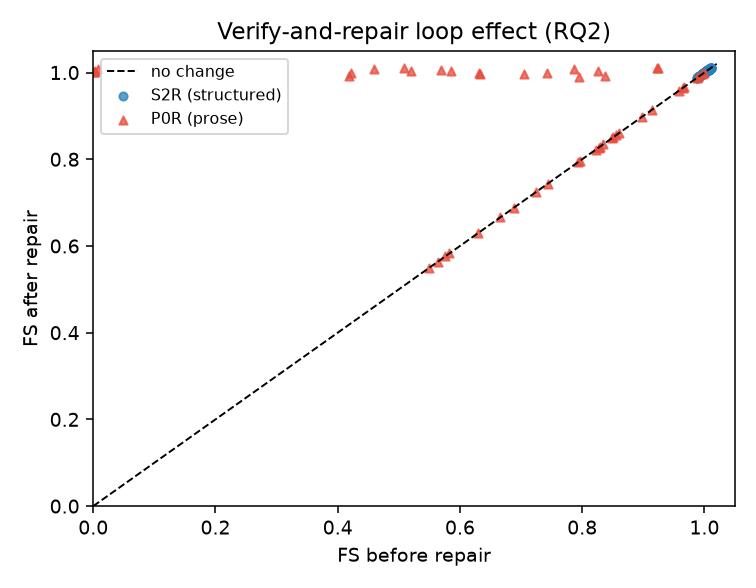
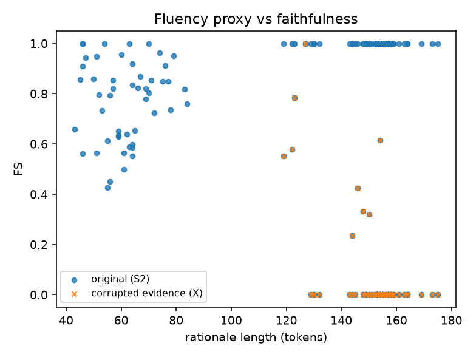

# Faithfulness-checked LLM rationales for ransomware verdicts

Generated: 2026-10-11T08:08:02+00:00

Study of whether LLM rationales for a memory-forensics ransomware classifier's verdicts are faithful to the underlying feature evidence. Everything is deterministic except rationale generation; the metric checks agreement with the model's evidence, not whether the model is right about ransomware.

## 1. Setup

- Dataset: CIC-MalMem-2022 (Kaggle mirror of the official `Obfuscated-MalMem2022.csv`; the UNB/CIC page is form-gated). 58023 rows after dedupe, 55 features.
- Split (group-aware, seed 42): train/val/test = 40540/5813/11670 rows; leak check: {'group_overlap': {'train_val': 0, 'train_test': 0, 'val_test': 0}, 'identical_rows': {'train_val': 0, 'train_test': 0, 'val_test': 0}}.
- Eval set: N=50 from the test split, strata {'tp': 20, 'tn': 15, 'fn': 8, 'fp': 7} (TP/TN/FN/FP), quotas {'tp': 20, 'tn': 15, 'fn': 8, 'fp': 7}.
- Classifier: XGBoost, test ROC-AUC raw=0.92726, calibrated=0.92726; confusion {'tn': 9265, 'fp': 509, 'fn': 813, 'tp': 1083}; Brier=0.08495.

## 2. LLM details

- Backend: **agent_queue**, model id `freebuff-desktop-agent`, generator `agent_queue:freebuff-desktop-agent`.
- Temperature 0.2, prompt versions {'T': 'template', 'P0': 'v0_zero_shot', 'P0R': 'v2_rules_fewshot', 'P2': 'v2_rules_fewshot', 'S2': 'v2_rules_fewshot', 'S2R': 'template'}, repair rounds 2.
- agent_queue: the generator is the coding agent's underlying model, which may be closed-weight; these are NOT open-weight results.

## 3. Per-arm faithfulness

| arm | n | FS | claim precision | claim precision lenient | hallucination rate | contradiction rate | evidence coverage | top1 mentioned rate | verdict consistency rate | FS pass rate | causal lift | suff (median) |
|---|---|---|---|---|---|---|---|---|---|---|---|---|
| T | 50 | 1.000 | 1.000 | 1.000 | 0.000 | 0.000 | 1.000 | 1.000 | 1.000 | 1.000 | 0.273 | 0.382 |
| P0 | 50 | 0.772 | 0.924 | 0.942 | 0.045 | 0.032 | 0.607 | 0.680 | 1.000 | 0.780 | 0.155 | 0.390 |
| P0R | 50 | 0.891 | 0.988 | 0.988 | 0.012 | 0.000 | 0.790 | 0.800 | 1.000 | 0.960 | 0.201 | 0.388 |
| P2 | 50 | 1.000 | 1.000 | 1.000 | 0.000 | 0.000 | 1.000 | 1.000 | 1.000 | 1.000 | 0.273 | 0.382 |
| S2 | 50 | 1.000 | 1.000 | 1.000 | 0.000 | 0.000 | 1.000 | 1.000 | 1.000 | 1.000 | 0.273 | 0.382 |
| S2R | 50 | 1.000 | 1.000 | 1.000 | 0.000 | 0.000 | 1.000 | 1.000 | 1.000 | 1.000 | 0.273 | 0.382 |
| X | 50 | 0.097 | 0.143 | 0.217 | 0.580 | 0.277 | 0.473 | 0.600 | 0.380 | 0.020 | 0.146 | 0.411 |

### Bootstrap 95% CIs (10,000 resamples)

| arm | FS (mean [95% CI]) | claim precision (mean [95% CI]) | coverage (mean [95% CI]) | hallucination (mean [95% CI]) | contradiction (mean [95% CI]) | FS pass rate (mean [95% CI]) | causal lift (mean [95% CI]) |
|---|---|---|---|---|---|---|---|
| T | 1.000 [1.000, 1.000] | 1.000 [1.000, 1.000] | 1.000 [1.000, 1.000] | 0.000 [0.000, 0.000] | 0.000 [0.000, 0.000] | 1.000 [1.000, 1.000] | 0.273 [0.178, 0.368] |
| P0 | 0.772 [0.728, 0.815] | 0.924 [0.878, 0.963] | 0.607 [0.535, 0.681] | 0.045 [0.014, 0.080] | 0.032 [0.007, 0.063] | 0.780 [0.660, 0.880] | 0.155 [0.064, 0.250] |
| P0R | 0.891 [0.847, 0.929] | 0.988 [0.970, 1.000] | 0.790 [0.709, 0.864] | 0.012 [0.000, 0.030] | 0.000 [0.000, 0.000] | 0.960 [0.900, 1.000] | 0.201 [0.109, 0.297] |
| P2 | 1.000 [1.000, 1.000] | 1.000 [1.000, 1.000] | 1.000 [1.000, 1.000] | 0.000 [0.000, 0.000] | 0.000 [0.000, 0.000] | 1.000 [1.000, 1.000] | 0.273 [0.178, 0.368] |
| S2 | 1.000 [1.000, 1.000] | 1.000 [1.000, 1.000] | 1.000 [1.000, 1.000] | 0.000 [0.000, 0.000] | 0.000 [0.000, 0.000] | 1.000 [1.000, 1.000] | 0.273 [0.178, 0.368] |
| S2R | 1.000 [1.000, 1.000] | 1.000 [1.000, 1.000] | 1.000 [1.000, 1.000] | 0.000 [0.000, 0.000] | 0.000 [0.000, 0.000] | 1.000 [1.000, 1.000] | 0.273 [0.178, 0.368] |
| X | 0.097 [0.039, 0.166] | 0.143 [0.087, 0.207] | 0.473 [0.403, 0.546] | 0.580 [0.510, 0.643] | 0.277 [0.220, 0.337] | 0.020 [0.000, 0.060] | 0.146 [0.058, 0.236] |

### Paired comparisons (Wilcoxon signed-rank + paired bootstrap)

| comparison | metric | mean diff (a-b) | 95% CI | Wilcoxon p | n |
|---|---|---|---|---|---|
| P0_vs_P0R | FS | -0.119 | [-0.167, -0.073] | 5.96e-05 | 50 |
| P0_vs_P0R | claim_precision | -0.065 | [-0.109, -0.027] | 7.06e-03 | 50 |
| P0_vs_P0R | hallucination_rate | +0.033 | [+0.008, +0.066] | 4.12e-02 | 50 |
| P0_vs_P0R | contradiction_rate | +0.032 | [+0.007, +0.063] | 4.22e-02 | 50 |
| P0_vs_P0R | evidence_coverage | -0.183 | [-0.257, -0.115] | 8.86e-05 | 50 |
| P0R_vs_P2 | FS | -0.109 | [-0.153, -0.071] | 1.82e-05 | 50 |
| P0R_vs_P2 | claim_precision | -0.012 | [-0.030, +0.000] | 1.80e-01 | 50 |
| P0R_vs_P2 | hallucination_rate | +0.012 | [+0.000, +0.030] | 1.80e-01 | 50 |
| P0R_vs_P2 | contradiction_rate | +0.000 | [+0.000, +0.000] | 1.00e+00 | 50 |
| P0R_vs_P2 | evidence_coverage | -0.210 | [-0.291, -0.136] | 1.82e-05 | 50 |
| P0_vs_P2 | FS | -0.228 | [-0.272, -0.185] | 5.18e-09 | 50 |
| P0_vs_P2 | claim_precision | -0.076 | [-0.122, -0.037] | 3.12e-03 | 50 |
| P0_vs_P2 | hallucination_rate | +0.045 | [+0.014, +0.080] | 1.73e-02 | 50 |
| P0_vs_P2 | contradiction_rate | +0.032 | [+0.007, +0.063] | 4.22e-02 | 50 |
| P0_vs_P2 | evidence_coverage | -0.393 | [-0.465, -0.319] | 7.62e-09 | 50 |
| P2_vs_S2 | FS | +0.000 | [+0.000, +0.000] | 1.00e+00 | 50 |
| P2_vs_S2 | claim_precision | +0.000 | [+0.000, +0.000] | 1.00e+00 | 50 |
| P2_vs_S2 | hallucination_rate | +0.000 | [+0.000, +0.000] | 1.00e+00 | 50 |
| P2_vs_S2 | contradiction_rate | +0.000 | [+0.000, +0.000] | 1.00e+00 | 50 |
| P2_vs_S2 | evidence_coverage | +0.000 | [+0.000, +0.000] | 1.00e+00 | 50 |
| S2_vs_S2R | FS | +0.000 | [+0.000, +0.000] | 1.00e+00 | 50 |
| S2_vs_S2R | claim_precision | +0.000 | [+0.000, +0.000] | 1.00e+00 | 50 |
| S2_vs_S2R | hallucination_rate | +0.000 | [+0.000, +0.000] | 1.00e+00 | 50 |
| S2_vs_S2R | contradiction_rate | +0.000 | [+0.000, +0.000] | 1.00e+00 | 50 |
| S2_vs_S2R | evidence_coverage | +0.000 | [+0.000, +0.000] | 1.00e+00 | 50 |
| S2_vs_X | FS | +0.903 | [+0.834, +0.961] | 4.78e-11 | 50 |
| S2_vs_X | claim_precision | +0.857 | [+0.793, +0.913] | 4.23e-10 | 50 |
| S2_vs_X | hallucination_rate | -0.580 | [-0.643, -0.510] | 1.20e-09 | 50 |
| S2_vs_X | contradiction_rate | -0.277 | [-0.337, -0.220] | 6.28e-09 | 50 |
| S2_vs_X | evidence_coverage | +0.527 | [+0.454, +0.597] | 1.63e-09 | 50 |

### Stratified by TP/TN/FN/FP

| arm | stratum | n | FS | claim precision | hallucination | pass rate |
|---|---|---|---|---|---|---|
| T | fn | 8 | 1.000 | 1.000 | 0.000 | 1.000 |
| T | fp | 7 | 1.000 | 1.000 | 0.000 | 1.000 |
| T | tn | 15 | 1.000 | 1.000 | 0.000 | 1.000 |
| T | tp | 20 | 1.000 | 1.000 | 0.000 | 1.000 |
| P0 | fn | 8 | 0.715 | 0.938 | 0.000 | 0.750 |
| P0 | fp | 7 | 0.839 | 1.000 | 0.000 | 1.000 |
| P0 | tn | 15 | 0.814 | 0.944 | 0.017 | 0.867 |
| P0 | tp | 20 | 0.740 | 0.876 | 0.099 | 0.650 |
| P0R | fn | 8 | 0.865 | 1.000 | 0.000 | 1.000 |
| P0R | fp | 7 | 0.877 | 1.000 | 0.000 | 1.000 |
| P0R | tn | 15 | 0.926 | 1.000 | 0.000 | 1.000 |
| P0R | tp | 20 | 0.879 | 0.971 | 0.029 | 0.900 |
| P2 | fn | 8 | 1.000 | 1.000 | 0.000 | 1.000 |
| P2 | fp | 7 | 1.000 | 1.000 | 0.000 | 1.000 |
| P2 | tn | 15 | 1.000 | 1.000 | 0.000 | 1.000 |
| P2 | tp | 20 | 1.000 | 1.000 | 0.000 | 1.000 |
| S2 | fn | 8 | 1.000 | 1.000 | 0.000 | 1.000 |
| S2 | fp | 7 | 1.000 | 1.000 | 0.000 | 1.000 |
| S2 | tn | 15 | 1.000 | 1.000 | 0.000 | 1.000 |
| S2 | tp | 20 | 1.000 | 1.000 | 0.000 | 1.000 |
| S2R | fn | 8 | 1.000 | 1.000 | 0.000 | 1.000 |
| S2R | fp | 7 | 1.000 | 1.000 | 0.000 | 1.000 |
| S2R | tn | 15 | 1.000 | 1.000 | 0.000 | 1.000 |
| S2R | tp | 20 | 1.000 | 1.000 | 0.000 | 1.000 |
| X | fn | 8 | 0.000 | 0.042 | 0.812 | 0.000 |
| X | fp | 7 | 0.000 | 0.143 | 0.595 | 0.000 |
| X | tn | 15 | 0.231 | 0.200 | 0.367 | 0.067 |
| X | tp | 20 | 0.068 | 0.142 | 0.642 | 0.000 |

### FS weight sensitivity

| arm | alpha=0.25 | alpha=0.5 (main) | alpha=1.0 | coverage weight=0 | coverage weight=1 |
|---|---|---|---|---|---|
| T | 1.000 | 1.000 | 1.000 | 1.000 | 1.000 |
| P0 | 0.787 | 0.772 | 0.747 | 0.957 | 0.587 |
| P2 | 1.000 | 1.000 | 1.000 | 1.000 | 1.000 |
| S2 | 1.000 | 1.000 | 1.000 | 1.000 | 1.000 |
| S2R | 1.000 | 1.000 | 1.000 | 1.000 | 1.000 |
| P0R | 0.893 | 0.891 | 0.887 | 0.994 | 0.788 |
| X | 0.121 | 0.097 | 0.067 | 0.110 | 0.084 |

### Repair loop (RQ2: does verify-and-repair help?)

| arm | n | mean FS before | mean FS after | pass before | pass after | mean rounds | samples repaired |
|---|---|---|---|---|---|---|---|
| P0R | 50 | 0.772 | 0.891 | 0.780 | 0.960 | 0.44 | 22/50 |
| S2R | 50 | 1.000 | 1.000 | 1.000 | 1.000 | 0.00 | 0/50 |



## 4. Metric validity

```json
{
  "flip_direction": {
    "recall": 1.0,
    "n": 50,
    "passed": true
  },
  "out_of_topk_feature": {
    "recall": 1.0,
    "n": 50,
    "passed": true
  },
  "value_30pct": {
    "recall": 0.98,
    "n": 50,
    "passed": true
  },
  "drop_top": {
    "recall": 1.0,
    "n": 50,
    "passed": true
  },
  "all_passed": true
}
```

```json
{
  "n": 50,
  "FS_original_S2": 1.0,
  "FS_corrupted_X": 0.09675156488774853,
  "FS_drop": 0.9032484351122515,
  "hallucination_rate_X": 0.58,
  "contradiction_rate_X": 0.2766666666666666
}
```

### Extractor accuracy (gold set: agent-drafted, NOT independently annotated)

```json
{
  "P0": {
    "status": "ran",
    "n_rationales": 10,
    "precision": 0.43333333333333335,
    "recall": 0.22033898305084745,
    "f1": 0.29213483146067415,
    "gold_source": "agent-drafted (not independently annotated)"
  },
  "P2": {
    "status": "ran",
    "n_rationales": 10,
    "precision": 0.95,
    "recall": 0.95,
    "f1": 0.9500000000000001,
    "gold_source": "agent-drafted (not independently annotated)"
  }
}
```

### Fluency vs faithfulness (RQ3)

```json
{
  "n": 150,
  "spearman_FS_vs_tokens": -0.051904471292560705,
  "spearman_FS_vs_flesch_kincaid": -0.020499426631374832,
  "spearman_FS_vs_rouge_l": 0.8090210303852213,
  "mean_tokens": 120.70666666666666,
  "mean_flesch_kincaid": 8.76309364131171,
  "mean_rouge_l_vs_template": 0.2213216076514099,
  "P0_only_n": 50,
  "P0_only_FS_vs_tokens": 0.055352513275356736,
  "P0_only_FS_vs_flesch_kincaid": 0.0928657325522016,
  "P0_only_FS_vs_rouge_l": -0.08076489490858263,
  "corrupted_mean_tokens": 150.28,
  "corrupted_mean_rouge_l_vs_template": 0.1726304545458431,
  "corrupted_mean_FS": 0.09675156488774853
}
```

Within the zero-shot prose arm (the only natural arm with FS variance),
none of the fluency proxies tracks faithfulness (|rho| <= 0.1, p >= 0.5).
The positive pooled correlation with ROUGE-L is driven by the
corrupted-evidence control, which is both lexically distant from the
reference and unfaithful: overlap flags gross mismatch, not unfaithfulness.
See the `P0_only_*` correlations for the unconfounded view.



## 5. LLM-judge cross-check (optional)

Status: not run — 

## 6. Qualitative examples

### Faithful examples (S2, structured)

### test_057948 — faithful (FS=1.000, pass=True, stratum=tp)

> {"verdict": "ransomware", "probability_stated": 0.897, "confidence_statement": null, "claims": [{"feature": "dlllist.avg_dlls_per_proc", "direction": "toward_ransomware", "level": "low", "value_stated": 38.5, "text": "38.5 DLLs per process is low and supports the verdict.", "extractor": "given"}, {"feature": "handles.ntimer", "direction": "toward_ransomware", "level": "typical", "value_stated": 120.0, "text": "120 timer handles is typical and leans toward ransomware.", "extractor": "given"}, {"feature": "handles.nthread", "direction": "toward_ransomware", "level": "typical", "value_stated": 843.0, "text": "843 thread handles is typical and leans toward ransomware.", "extractor": "given"}, {"feature": "ldrmodules.not_in_mem_avg", "direction": "toward_ransomware", "level": "low", "value_stated": 0.02831, "text": "0.02831 loader-listed modules missing from memory per process is low.", "extr

Verifier:

- `dlllist.avg_dlls_per_proc` → **supported**
- `handles.ntimer` → **supported**
- `handles.nthread` → **supported**
- `ldrmodules.not_in_mem_avg` → **supported**
- `psxview.not_in_csrss_handles_false_avg` → **supported**
- `psxview.not_in_session_false_avg` → **supported**

### test_057797 — faithful (FS=1.000, pass=True, stratum=fn)

> {"verdict": "benign", "probability_stated": 0.326, "confidence_statement": "The verdict is benign but the evidence is mixed, so it is not certain.", "claims": [{"feature": "dlllist.avg_dlls_per_proc", "direction": "toward_ransomware", "level": "low", "value_stated": 38.7, "text": "38.7 DLLs per process is low and pushes toward ransomware.", "extractor": "given"}, {"feature": "handles.nkey", "direction": "toward_ransomware", "level": "typical", "value_stated": 733.0, "text": "733 registry-key handles is typical but pushes toward ransomware.", "extractor": "given"}, {"feature": "psxview.not_in_deskthrd_false_avg", "direction": "toward_benign", "level": "typical", "value_stated": 0.1463, "text": "0.1463 benign deskthrd cross-view mismatches per process is typical and benign-leaning.", "extractor": "given"}, {"feature": "svcscan.nactive", "direction": "toward_ransomware", "level": "low", "va

Verifier:

- `dlllist.avg_dlls_per_proc` → **supported**
- `handles.nkey` → **supported**
- `psxview.not_in_deskthrd_false_avg` → **supported**
- `svcscan.nactive` → **supported**
- `handles.nthread` → **supported**
- `ldrmodules.not_in_init_avg` → **supported**

### test_056459 — faithful (FS=1.000, pass=True, stratum=tp)

> {"verdict": "ransomware", "probability_stated": 0.607, "confidence_statement": "The evidence is mixed but the balance favours ransomware.", "claims": [{"feature": "pslist.avg_threads", "direction": "toward_ransomware", "level": "very_low", "value_stated": 9.23, "text": "9.23 threads per process is very low and supports the verdict.", "extractor": "given"}, {"feature": "handles.nthread", "direction": "toward_ransomware", "level": "typical", "value_stated": 714.0, "text": "714 thread handles is typical and leans toward ransomware.", "extractor": "given"}, {"feature": "handles.avg_handles_per_proc", "direction": "toward_benign", "level": "typical", "value_stated": 271.9, "text": "271.9 handles per process is typical and pushes toward benign.", "extractor": "given"}, {"feature": "handles.nhandles", "direction": "toward_ransomware", "level": "typical", "value_stated": 11692, "text": "11,692 t

Verifier:

- `pslist.avg_threads` → **supported**
- `handles.nthread` → **supported**
- `handles.avg_handles_per_proc` → **supported**
- `handles.nhandles` → **supported**
- `handles.nkey` → **supported**
- `ldrmodules.not_in_load` → **supported**

### Unfaithful examples (P0, zero-shot prose)

### test_033454 — UNFAITHFUL (FS=0.427, pass=False, stratum=tp)

> Ransomware, probability 0.636. The picture is mixed: a very low average thread count (9.33), low loader-inconsistency averages (0.0276) and a typical section-handle count (179) pushed toward ransomware, while mutex handles (264) and file handles (661) lean benign or neutral. The probability barely clears the threshold, so this is an uncertain verdict that warrants manual verification.

Verifier:

- `handles.nmutant` → **supported**
- `handles.nfile` → **contradicted** (failed: direction_ok)

### test_032517 — UNFAITHFUL (FS=0.451, pass=False, stratum=tp)

> Ransomware, probability 0.917. Thread (859) and event (3,115) handle counts plus the average handles per process (215.9) are typical values that nonetheless pushed toward ransomware, while the per-process averages for modules missing from memory and absent from the load list (0.0276) and DLLs per process (39.6) contributed as well. The verdict is comfortably above the threshold.

Verifier:

- `handles.avg_handles_per_proc` → **out_of_topk** (failed: feature_exists)
- `dlllist.avg_dlls_per_proc` → **supported**

### test_032521 — UNFAITHFUL (FS=0.498, pass=False, stratum=tp)

> This image is classified as ransomware with probability 0.885, on mixed evidence. DLLs per process (39.2), mutant (230) and file (630) handles, the missing-from-memory module count (43) and average handles per process (216.0) all lean toward ransomware. The loader-inconsistency average (0.0292) is the one counter-signal, leaning benign. The verdict is still comfortably malicious, and I would isolate the host pending review.

Verifier:

- `dlllist.avg_dlls_per_proc` → **supported**
- `handles.avg_handles_per_proc` → **out_of_topk** (failed: feature_exists)

## 7. Limitations

- SHAP values are model attributions, not ground-truth causality; the causal tests are ablations under the model, not real-world interventions.
- Median-imputation ablation can create off-distribution points; a marginal-resampling variant is reported alongside it.
- CIC-MalMem-2022 is a lab-generated dataset (memory captures of known samples) and may not generalise to real-world ransomware; benign rows carry no capture ids, so residual near-duplicate leakage among benign rows cannot be fully excluded.
- Small N (see eval set above); differences under ~0.05 are not reliable.
- Glossary descriptions are hand-written and are the only allowed semantic source for the generator.
- Single generator; when the backend is `agent_queue` the generator is the coding agent's underlying model (possibly closed-weight) — not an open-weight result.
- The metric measures agreement between rationale and the model's evidence, not whether the model is correct about ransomware.

## 8. Reproduction

```bash
make setup       # venv + deps
make download    # CIC-MalMem-2022 -> data/raw
make preprocess  # clean, dedupe, group-aware split
make train       # tune + fit + calibrate + classifier report
make evidence    # SHAP + evidence JSON + additivity/schema checks
make generate    # arms T/P0/P0R/P2/S2/S2R (+X control); may exit 20 (agent_queue)
make verify      # extraction + faithfulness + causal tests
make validity    # metric validity + spot check
make eval        # stats, plots, outputs/report.md
make test        # pytest
```

Seeds: everything uses seed 42.

## 9. Acceptance checks

| Phase | Check | Result | Details |
|---|---|---|---|
| laya | laya_available_fallback | PASS | stage is a no-op: cfg.laya.enabled=false (opt in with `make setup-laya` then set laya.enabled: true, or pass --force) |
| laya | laya_fs_independence | PASS | not applicable: the layer is disabled/absent |
| laya | laya_full_run_recorded | PASS | reference run in summary_full_run.json: 7 arms x 50 samples, median gate 4649 ms, LAR P0=0.931, P0R=0.990, P2=0.953, S2=1.000, S2R=1.000, T=0.997, X=0.387 (checkpoint typed-decisions, device cpu, zero-shot=True; last invocation overwrote summary.json) |
| laya | laya_gate_latency | PASS | not applicable: the layer is disabled/absent |
| phase1/3 | eval set selected | PASS | n=50 composition={'tp': 20, 'tn': 15, 'fn': 8, 'fp': 7} |
| phase2 | test ROC-AUC >= 0.95 | FAIL | ROC-AUC=0.92726 on a group-aware (capture-level, leakage-free) split; the spec threshold assumes the usual near-duplicate-leaky split - see docs/DEVIATIONS.md #4 and models/metrics_rowlevel.json |
| phase3 | SHAP additivity <= 1e-3 | PASS | max/sum(shap)+base-margin/=6.70e-06 |
| phase3 | evidence JSON validates against schema | PASS | 50 files, 0 invalid |
| phase5 | agent_queue round trip used | PASS | LLM extractor fallback ran on agent_queue answers |
| phase6 | template arm FS >= 0.99 | PASS | T FS=1.000 |
| phase7 | corrupted-evidence control drops FS | PASS | S2 1.000 -> X 0.097 (drop 0.903) |
| phase7 | extractor gold set produced | PASS | P0 P/R=0.43/0.22; P2 P/R=0.95/0.95 |
| phase7 | perturbation detection recall >= 0.95 | PASS | flip_direction=1.00, out_of_topk_feature=1.00, value_30pct=0.98, drop_top=1.00 |
| phase8 | repair before/after table produced | PASS | S2R FS=1.000; P0R FS=0.891 |
| usage | batch triage CLI ran | PASS | 5 rows from data/raw/CIC-MalMem-2022.csv -> outputs/triage_smoke.csv |
| usage | single-sample triage CLI ran | PASS | test_003028: benign p=0.029, 6 evidence features, FS=1.000 (template) |

**15/16 checks passed.**

## Appendix A — data summary

# Data summary — CIC-MalMem-2022

- Raw file: `/home/faddy/Desktop/githubrepos/ransomware-rationale/data/raw/CIC-MalMem-2022.csv`
- Raw rows: 58596
- Rows dropped for NaN features: 0
- Exact duplicate rows dropped: 573
- Final rows: 58023
- Features: 55
- Generated: 2026-10-10T16:52:51+00:00

## Leakage structure (important)

- The Category column encodes the source memory capture of every malware row (e.g. `Ransomware-Shade-<hash>-7.raw`).
- Distinct malware captures (hashes): 2844; rows per capture: mean 10.0, median 10, max 20.
- Malware rows without a capture hash: 429.
- Malware rows from the same capture are kept in ONE split via group-aware splitting (`group_id`).
- Benign rows carry NO capture ids in this mirror; they are split row-level. Near-duplicate benign dumps may therefore span splits — documented limitation.

## `Class` column

```
Class
Benign     29227
Malware    28796
```

## Binary task (`y_binary`: ransomware vs rest)

```
y_binary
not_ransomware    48500
ransomware         9523
```

## 3-class task

```
y_3class
benign           29227
other_malware    19273
ransomware        9523
```

## Malware classes (non-benign rows)

```
malware_class
Spyware       9797
Ransomware    9523
Trojan        9476
```

## Ransomware families

```
family
Shade    2125
Ako      1999
Conti    1987
Maze     1754
Pysa     1658
```

## Other-malware families

```
family
Transponder     2403
180solutions    1999
CWS             1999
Scar            1999
Refroso         1996
Gator           1990
Emotet          1967
Zeus            1946
Reconyc         1568
TIBS            1406
```


## Appendix B — classifier report

# Classifier report — ransomware vs rest (CIC-MalMem-2022)

Generated: 2026-10-10T16:57:02+00:00

## Setup

- Model: xgboost; best params: `{"subsample": 0.7, "reg_lambda": 1.0, "reg_alpha": 0.0, "min_child_weight": 1, "max_depth": 8, "learning_rate": 0.2, "colsample_bytree": 0.8}`
- Tuning: RandomizedSearchCV n_iter=30 (requested 30), 3-fold CV, metric=average_precision, budget=1200.0s
- Early stopping on 10% train slice -> 191 trees; refit on full train
- Calibration: sigmoid on val (5813 rows)
- Train/val/test rows: 40540/5813/11670; seed=42
- Duplicate rows removed before splitting (see outputs/data_summary.md)

**Acceptance (Phase 2): test ROC-AUC >= 0.95.**
Observed raw test ROC-AUC = 0.92726.
## Test metrics

### Raw booster (uncalibrated)

- n=11670, accuracy=0.8847, precision=0.6566, recall=0.6092, F1=0.6320
- ROC-AUC=0.92726, PR-AUC=0.69773, Brier=0.08221
- confusion: TN=9170 FP=604 FN=741 TP=1155

### Calibrated

- n=11670, accuracy=0.8867, precision=0.6803, recall=0.5712, F1=0.6210
- ROC-AUC=0.92726, PR-AUC=0.69773, Brier=0.08495
- confusion: TN=9265 FP=509 FN=813 TP=1083

## Validation metrics (calibration split)

### Raw booster (uncalibrated)

- n=5813, accuracy=0.9085, precision=0.7358, recall=0.6928, F1=0.7137
- ROC-AUC=0.95193, PR-AUC=0.80893, Brier=0.06366
- confusion: TN=4618 FP=238 FN=294 TP=663

### Calibrated

- n=5813, accuracy=0.9105, precision=0.7721, recall=0.6479, F1=0.7045
- ROC-AUC=0.95193, PR-AUC=0.80893, Brier=0.06548
- confusion: TN=4673 FP=183 FN=337 TP=620

## Figures

- `outputs/figs/confusion_test.png` — confusion matrix
- `outputs/figs/reliability_test.png` — reliability curve
- `outputs/figs/roc_test.png`, `outputs/figs/pr_test.png`

